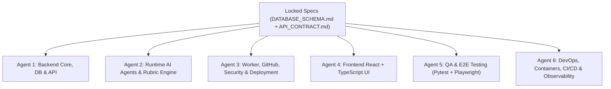

# Agent Team Specification & Parallel Execution Architecture

DevTrack AI uses a **Dual-Layer Agent Architecture**:

1. **Layer A — Runtime Application Agents (In-Product Gemini Agents):** Specialized LLM agents inside `backend/app/agents/` that power DevTrack AI's mentoring, rubric extraction, progress evaluation, diary comparison, security explanation, and on-call incident diagnosis.
2. **Layer B — Parallel Development Agent Team (Multi-Agent Engineering Workstreams):** Specialized coding agents configured via hierarchical `AGENTS.md` files, `.agents/agents/*.md` profiles, and `.agents/skills/*/SKILL.md` runbooks so multiple AI agents can build, test, and instrument the codebase **simultaneously without merge conflicts**.

---

## Layer A: Runtime Application Agents (`backend/app/agents/`)

All runtime agents invoke the official `google-genai` SDK (`GEMINI_API_KEY`, `GEMINI_MODEL` from `.env`) using strict Pydantic structured output schemas (`response_schema`). None of these agents may mutate external GitHub repositories; they are strictly **advisory and read-only**.

| Runtime Agent | Module Path | Input Context | Structured Output Schema | Core Responsibilities |
|---|---|---|---|---|
| **1. Project Mentor / Orchestrator** | `backend/app/agents/project_mentor.py` | Project config, rubric scorecard, progress snapshot, diary snapshot, security summary, deployment status | `MentorEvaluationOutput` | Synthesizes findings from all specialist services/agents, detects stalled development and scope creep, compares against previous commit SHA snapshots, and generates high-ROI prioritized next recommendations (`Recommendations`). |
| **2. Rubric Analyst** | `backend/app/agents/rubric_analyst.py` | Raw rubric text/Markdown/PDF/URL content OR repository evidence bundle + versioned `RubricCriteria` | `ExtractedRubricOutput` / `ScorecardEvaluationOutput` | (a) Extracts official criteria, point values, scoring levels, and passing thresholds from custom rubrics; (b) Evaluates repository evidence against each criterion's exact official scoring levels, assigning `ai_proposed_points`, `ai_confidence`, `score_state`, and `evidence_ids`. |
| **3. Progress Analyst** | `backend/app/agents/progress_analyst.py` | Commit history, changed files since `previous_commit_sha`, Assessment Milestones, Development Milestones | `ProgressEvaluationOutput` | Evaluates **Development Completion** (`completed`, `partial`, `outstanding` tasks, deadline adherence) independently from **Expected Course Score** (`estimated`, `verified`, `potential` points). |
| **4. Diary Analyst** | `backend/app/agents/diary_analyst.py` | Discovered diary markdown/text file(s) + recent Git commit log & diff summary | `DiaryAnalysisOutput` | Extracts completed work, blockers, architectural decisions, and next steps from the developer's diary, and cross-checks claims against actual Git history to highlight discrepancies. |
| **5. Security Reviewer** | `backend/app/agents/security_reviewer.py` | Deterministic JSON outputs from Semgrep, Gitleaks, `pip-audit`, `npm audit`, and Bandit (with secret values redacted) | `SecurityReviewOutput` | Explains technical vulnerabilities in plain developer-friendly language, deduplicates scanner noise, assesses exploitability in a course project context, and ranks remediation steps. |
| **6. Bounded On-Call Agent** *(Phase 4)* | `backend/app/agents/oncall_agent.py` | Read-only Prometheus metric queries, Loki log streams, Tempo trace summaries, alert payload | `OnCallDiagnosisOutput` | Diagnoses user-impacting alerts (HTTP 5xx spikes, worker timeouts, DB pool exhaustion), cites telemetry evidence, and proposes safe human-approved remediation steps. |

### Deterministic Services (Non-LLM)
- **Repository & GitHub Inspector (`backend/app/services/github_service.py`)**: Read-only GitHub REST API + shallow Git clone inspection in isolated temporary directories.
- **Deterministic Security Scanner Runner (`backend/app/services/security_scanner.py`)**: Executes Semgrep, Gitleaks, `pip-audit`, `npm audit`, and Bandit with strict timeouts and resource caps, never executing untrusted repo scripts.
- **Deployment Health Monitor (`backend/app/services/deployment_monitor.py`)**: SSRF-protected `httpx` client checking public HTTP/HTTPS status, TLS validity, and latency.
- **Ephemeral Notification Dispatcher (`backend/app/services/notification_service.py`)**: Sends one-time SMTP email notifications using in-memory recipient addresses that are immediately purged.

---

## Layer B: Parallel Development Agent Team (`.agents/agents/`)

To allow simultaneous development by multiple agents (e.g., via Antigravity subagents or parallel branches/worktrees), the repository is partitioned into **6 non-overlapping ownership tracks**.

### Interface Lock Contracts (Shared Source of Truth)
Before parallel agents write implementation code, two contracts act as the immutable handshake:
1. **Database Schema Contract:** `docs/specs/DATABASE_SCHEMA.md` & `backend/app/models/`
2. **REST & Schema Contract:** `docs/specs/API_CONTRACT.md` & `backend/app/schemas/`

### File Ownership Matrix (Zero-Conflict Boundaries)

| Development Agent Track | Profile File | Exclusive Write Ownership | Read-Only Dependencies |
|---|---|---|---|
| **Track 1: Backend Core & API Architect** | `.agents/agents/backend-core-agent.md` | `backend/app/core/**`, `backend/app/db/**`, `backend/app/models/**`, `backend/app/schemas/**`, `backend/app/api/**`, `backend/app/main.py` | `docs/specs/**`, `.env.example` |
| **Track 2: AI & Rubric Engine Specialist** | `.agents/agents/ai-agents-specialist.md` | `backend/app/agents/**`, `backend/app/services/rubric_service.py`, `docs/rubrics/**` | `backend/app/schemas/**`, `docs/PRODUCT_SPEC.md` |
| **Track 3: Integrations, Security & Worker Specialist** | `.agents/agents/integrations-worker-agent.md` | `backend/app/worker/**`, `backend/app/services/github_service.py`, `backend/app/services/diary_service.py`, `backend/app/services/security_scanner.py`, `backend/app/services/deployment_monitor.py`, `backend/app/services/notification_service.py` | `backend/app/models/**`, `backend/app/schemas/**`, `backend/app/agents/**` |
| **Track 4: Frontend UI Engineer** | `.agents/agents/frontend-ui-agent.md` | `frontend/src/**`, `frontend/public/**`, `frontend/index.html`, `frontend/package.json`, `frontend/vite.config.ts`, `frontend/tsconfig.json` | `docs/specs/API_CONTRACT.md` |
| **Track 5: QA & Test Automation Engineer** | `.agents/agents/qa-testing-agent.md` | `backend/tests/**`, `frontend/e2e/**`, `frontend/playwright.config.ts`, `pytest.ini` | All `backend/app/**` and `frontend/src/**` |
| **Track 6: DevOps, Infra & Observability Engineer** | `.agents/agents/devops-observability-agent.md` | `docker-compose.yml`, `docker-compose.prod.yml`, `backend/Dockerfile`, `frontend/Dockerfile`, `infra/**`, `.github/workflows/**`, `Makefile` | All service entrypoints & health endpoints |

---

## Coordination Protocol for Simultaneous Agent Execution

1. **Contract-First Rule:** All agents treat `backend/app/schemas/api_contracts.py` and `docs/specs/API_CONTRACT.md` as the frozen contract. If an agent needs a schema change, it must update `docs/specs/API_CONTRACT.md` and run the `api-contract-sync` skill.
2. **Service Dependency Injection:** Track 1 (API endpoints) calls service interfaces via clean Python protocols/functions in `backend/app/services/` so Track 1, Track 2, and Track 3 can develop in parallel using deterministic mocks until wired together.
3. **Mock-Ready Frontend API Client:** Track 4 (Frontend) consumes `/api/v1/*` exclusively through `frontend/src/api/client.ts` typed directly against `docs/specs/API_CONTRACT.md`.
4. **Verification Gate:** Every agent must run its track's verification command (`pytest`, `npm run typecheck`, `docker compose config`) before marking a task complete.

