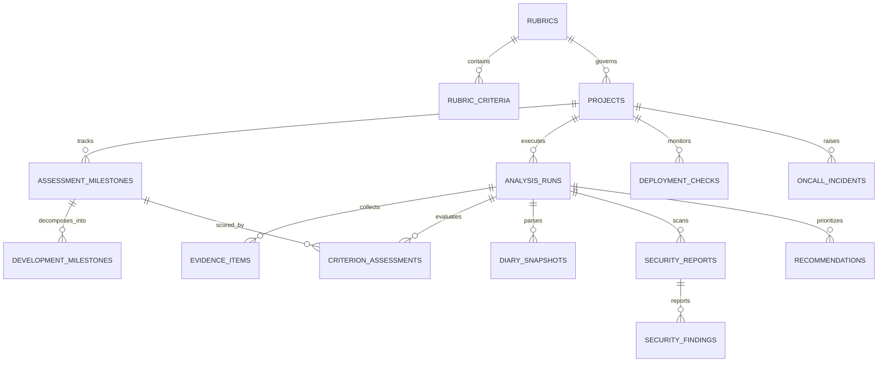

# Database Schema & Entity Model Specification

## 1. Design Principles

1. **Rubric Versioning:** Course rubrics are immutable once versioned (`rubrics` + `rubric_criteria`). Updating a rubric creates a new version row so existing project assessments are never silently mutated.
2. **Two-Tier Milestones:**
   - **Assessment Milestones (`assessment_milestones`)**: Represent official rubric criteria for a project, holding official point values and an explicit approval gate (`is_approved`).
   - **Development Milestones (`development_milestones`)**: Represent actionable engineering tasks linked to an assessment milestone. Completing all development milestones does **not** automatically award the assessment points.
3. **Explicit Score States & Human Override:** Every criterion assessment (`criterion_assessments`) has a `score_state` (`estimated`, `verified`, `needs_review`). When a human reviewer overrides a score, `ai_proposed_points` and `ai_reasoning` remain preserved alongside `human_override_points` and `human_override_reason`.
4. **Immutable Commit-Linked Snapshots:** Every daily or manual analysis run (`analysis_runs`) records the exact Git `commit_sha` and produces historical score/progress snapshots.
5. **Zero Persistent Email Storage:** There is **no** `notification_email` column anywhere in PostgreSQL. One-time notification email addresses live strictly in an in-memory Python dictionary inside the worker/backend process keyed by `analysis_run_id` and are wiped immediately upon dispatch or failure.

---

## 2. Entity-Relationship Overview

---

## 3. Table Definitions (SQLAlchemy 2.0 Target)

### 3.1 `rubrics`
Stores versioned course rubrics (built-in or user-ingested).
- `id`: `UUID` (PK)
- `slug`: `String(100)` (indexed, e.g., `ai-dev-tools-zoomcamp-2026`)
- `title`: `String(255)`
- `course_name`: `String(255)`
- `source_type`: `Enum('builtin', 'url', 'pdf', 'markdown', 'text')`
- `source_url`: `String(1024)` (nullable)
- `raw_content`: `Text` (retains original rubric text/markdown)
- `version`: `String(50)` (e.g., `2026.1.0`)
- `retrieved_at`: `DateTime(timezone=True)`
- `is_official`: `Boolean` (distinguishes official course rubrics from custom/AI-extracted rubrics)
- `max_points`: `Integer` (e.g., `24`)
- `passing_threshold`: `Integer` (nullable, e.g., `10`)
- `created_at`: `DateTime(timezone=True)`

### 3.2 `rubric_criteria`
Official criteria belonging to a specific `rubrics.id`.
- `id`: `UUID` (PK)
- `rubric_id`: `UUID` (FK -> `rubrics.id`, cascade delete)
- `code`: `String(100)` (e.g., `ci_cd`, `application`)
- `name`: `String(255)`
- `description`: `Text`
- `display_order`: `Integer`
- `max_points`: `Integer`
- `scoring_levels`: `JSONB` (list of `{points: int, description: str}`)
- `required_evidence_types`: `JSONB` (list of evidence type strings)

### 3.3 `projects`
Represents a tracked course repository under the single predefined account.
- `id`: `UUID` (PK)
- `name`: `String(255)`
- `description`: `Text` (nullable)
- `github_repo_url`: `String(512)` (must be a public `https://github.com/<owner>/<repo>` URL)
- `github_owner`: `String(128)`
- `github_repo`: `String(128)`
- `default_branch`: `String(128)` (default `'main'`)
- `course_name`: `String(255)`
- `rubric_id`: `UUID` (FK -> `rubrics.id`)
- `status`: `Enum('active', 'paused', 'archived', 'completed')`
- `start_date`: `Date` (nullable)
- `target_date`: `Date` (nullable)
- `weekly_hours`: `Integer` (default `10`)
- `diary_path`: `String(512)` (nullable; manual override or auto-discovered path)
- `deployment_url`: `String(512)` (nullable; manual override or auto-discovered URL)
- `daily_schedule_cron`: `String(64)` (default `'0 6 * * *'`)
- `milestones_approved`: `Boolean` (default `False`; generated milestones require user approval)
- `last_analysis_at`: `DateTime(timezone=True)` (nullable)
- `created_at`: `DateTime(timezone=True)`
- `updated_at`: `DateTime(timezone=True)`

### 3.4 `assessment_milestones`
Official course criteria instantiated for a specific project.
- `id`: `UUID` (PK)
- `project_id`: `UUID` (FK -> `projects.id`, cascade delete)
- `rubric_criterion_id`: `UUID` (FK -> `rubric_criteria.id`)
- `title`: `String(255)`
- `max_points`: `Integer`
- `target_date`: `Date` (nullable)
- `is_approved`: `Boolean` (default `False`)
- `display_order`: `Integer`

### 3.5 `development_milestones`
Actionable engineering tasks contributing to an `assessment_milestone`.
- `id`: `UUID` (PK)
- `project_id`: `UUID` (FK -> `projects.id`, cascade delete)
- `assessment_milestone_id`: `UUID` (FK -> `assessment_milestones.id`, cascade delete)
- `title`: `String(255)`
- `description`: `Text` (nullable)
- `status`: `Enum('outstanding', 'partial', 'completed')`
- `source`: `Enum('ai_generated', 'user_created')`
- `is_approved`: `Boolean` (default `False`)
- `due_date`: `Date` (nullable)
- `estimated_effort_hours`: `Float` (nullable)
- `display_order`: `Integer`
- `completed_at`: `DateTime(timezone=True)` (nullable)

### 3.6 `analysis_runs`
Tracks every automated daily or manual analysis job and serves as the PostgreSQL-backed job queue record.
- `id`: `UUID` (PK)
- `project_id`: `UUID` (FK -> `projects.id`, cascade delete)
- `trigger_type`: `Enum('initial', 'daily', 'manual')`
- `status`: `Enum('queued', 'running', 'completed', 'failed')`
- `commit_sha`: `String(64)` (nullable until fetched)
- `previous_commit_sha`: `String(64)` (nullable)
- `estimated_total_points`: `Integer` (default `0`)
- `verified_total_points`: `Integer` (default `0`)
- `max_total_points`: `Integer` (default `24`)
- `dev_completion_pct`: `Float` (default `0.0`)
- `summary_markdown`: `Text` (nullable)
- `stalled_flag`: `Boolean` (default `False`)
- `scope_creep_flag`: `Boolean` (default `False`)
- `error_message`: `Text` (nullable)
- `started_at`: `DateTime(timezone=True)` (nullable)
- `completed_at`: `DateTime(timezone=True)` (nullable)
- `created_at`: `DateTime(timezone=True)`

### 3.7 `evidence_items`
Concrete repository or operational artifacts discovered during an analysis run.
- `id`: `UUID` (PK)
- `analysis_run_id`: `UUID` (FK -> `analysis_runs.id`, cascade delete)
- `project_id`: `UUID` (FK -> `projects.id`, cascade delete)
- `evidence_type`: `Enum('commit', 'source_file', 'readme', 'documentation', 'ci_workflow', 'test_result', 'docker_compose', 'deployment_url', 'observability_config', 'security_report', 'agent_config', 'diary_entry')`
- `title`: `String(255)`
- `path_or_url`: `String(1024)`
- `commit_sha`: `String(64)` (nullable)
- `snippet`: `Text` (nullable, bounded excerpt)
- `metadata_json`: `JSONB` (default `{}`)
- `created_at`: `DateTime(timezone=True)`

### 3.8 `criterion_assessments`
Per-criterion scoring and evidence links for a given `analysis_run`.
- `id`: `UUID` (PK)
- `analysis_run_id`: `UUID` (FK -> `analysis_runs.id`, cascade delete)
- `project_id`: `UUID` (FK -> `projects.id`, cascade delete)
- `assessment_milestone_id`: `UUID` (FK -> `assessment_milestones.id`, cascade delete)
- `criterion_code`: `String(100)`
- `max_points`: `Integer`
- `ai_proposed_points`: `Integer`
- `ai_reasoning`: `Text`
- `ai_confidence`: `Float` (0.0 to 1.0)
- `missing_for_next_level`: `Text` (nullable)
- `score_state`: `Enum('estimated', 'verified', 'needs_review')`
- `human_override_points`: `Integer` (nullable)
- `human_override_reason`: `Text` (nullable)
- `overridden_at`: `DateTime(timezone=True)` (nullable)
- `evidence_ids`: `JSONB` (list of `evidence_items.id` UUID strings)

Effective points calculation:
`effective_points = human_override_points if human_override_points is not None else ai_proposed_points`

### 3.9 `diary_snapshots`
Structured extraction from the developer's project diary compared against Git activity.
- `id`: `UUID` (PK)
- `analysis_run_id`: `UUID` (FK -> `analysis_runs.id`, cascade delete)
- `project_id`: `UUID` (FK -> `projects.id`, cascade delete)
- `discovered_path`: `String(512)`
- `completed_work`: `JSONB` (list of strings)
- `blockers`: `JSONB` (list of strings)
- `decisions`: `JSONB` (list of strings)
- `next_steps`: `JSONB` (list of strings)
- `git_alignment_summary`: `Text`
- `discrepancies`: `JSONB` (list of `{claim: str, git_reality: str, severity: str}`)
- `created_at`: `DateTime(timezone=True)`

### 3.10 `security_reports` & `security_findings`
Deterministic scanner results and Gemini prioritization.
- **`security_reports`**:
  - `id`: `UUID` (PK)
  - `analysis_run_id`: `UUID` (FK -> `analysis_runs.id`, cascade delete)
  - `project_id`: `UUID` (FK -> `projects.id`, cascade delete)
  - `commit_sha`: `String(64)`
  - `overall_status`: `Enum('pass', 'warning', 'critical')`
  - `scanners_executed`: `JSONB` (e.g., `["semgrep", "gitleaks", "pip-audit", "npm-audit", "bandit"]`)
  - `ai_executive_summary`: `Text`
  - `created_at`: `DateTime(timezone=True)`
- **`security_findings`**:
  - `id`: `UUID` (PK)
  - `security_report_id`: `UUID` (FK -> `security_reports.id`, cascade delete)
  - `scanner`: `String(64)`
  - `rule_id`: `String(255)`
  - `severity`: `Enum('info', 'low', 'medium', 'high', 'critical')`
  - `file_path`: `String(512)` (nullable)
  - `line_number`: `Integer` (nullable)
  - `raw_message`: `Text` (redacted of any raw secret values)
  - `ai_explanation`: `Text` (nullable)
  - `ai_remediation`: `Text` (nullable)
  - `priority_rank`: `Integer` (nullable)

### 3.11 `deployment_checks`
SSRF-safe HTTP/HTTPS health monitoring records.
- `id`: `UUID` (PK)
- `project_id`: `UUID` (FK -> `projects.id`, cascade delete)
- `analysis_run_id`: `UUID` (FK -> `analysis_runs.id`, nullable)
- `target_url`: `String(512)`
- `discovery_source`: `Enum('readme', 'config', 'manual')`
- `is_reachable`: `Boolean`
- `http_status_code`: `Integer` (nullable)
- `https_valid`: `Boolean`
- `response_time_ms`: `Float` (nullable)
- `error_detail`: `String(512)` (nullable)
- `checked_at`: `DateTime(timezone=True)`

### 3.12 `recommendations`
High-ROI prioritized next actions generated by the AI Project Mentor.
- `id`: `UUID` (PK)
- `analysis_run_id`: `UUID` (FK -> `analysis_runs.id`, cascade delete)
- `project_id`: `UUID` (FK -> `projects.id`, cascade delete)
- `rank`: `Integer`
- `suggested_task`: `String(255)`
- `rationale`: `Text`
- `related_criterion_code`: `String(100)`
- `potential_points_delta`: `Integer`
- `priority`: `Enum('critical', 'high', 'medium', 'low')`
- `estimated_effort_hours`: `Float` (nullable)
- `technical_risk`: `Enum('low', 'medium', 'high')`
- `supporting_evidence_ids`: `JSONB` (list of UUID strings)
- `is_completed`: `Boolean` (default `False`)

### 3.13 `oncall_incidents`
Persisted Alertmanager alert history for the History tab + remediation plan display.
Advisory read-only: `diagnosis_json` stores `recommended_actions` text only — remediation is never executed.
Zero persistent email storage: NO email column exists; `alert_payload_json` is redacted of emails/JWTs/secrets before persistence.
- `id`: `UUID` (PK)
- `alert_name`: `String(255)` (from `labels.alertname`)
- `severity`: `String(64)` (from `labels.severity`, default `'unknown'`)
- `service`: `String(255)` (from `labels.service`, default `'unknown'`)
- `status`: `Enum('firing', 'acknowledged', 'resolved')`
- `fingerprint`: `String(255)` (indexed; dedupe key with `starts_at`)
- `starts_at`: `DateTime(timezone=True)` (from `startsAt`)
- `ends_at`: `DateTime(timezone=True)` (nullable, from `endsAt`)
- `alert_payload_json`: `JSONB` (redacted Alertmanager alert snapshot; never emails/JWTs/keys)
- `diagnosis_json`: `JSONB` (full `OnCallDiagnosisResponse`: `incident_summary`, `root_cause_hypothesis`, `confidence`, `evidence_citations`, `recommended_actions`, `read_only_verified`)
- `confidence`: `Float` (default `0.0`, mirrors `diagnosis_json.confidence`)
- `read_only_verified`: `Boolean` (default `True`)
- `acknowledge_note`: `Text` (nullable, set via `POST .../acknowledge`)
- `project_id`: `UUID` (nullable, FK -> `projects.id`, `SET NULL` on delete)
- `created_at`: `DateTime(timezone=True)`
- `updated_at`: `DateTime(timezone=True)`

Dedupe rule: webhook `POST` with an existing `(fingerprint, starts_at)` row updates that row (status/`ends_at`/payload) instead of inserting a duplicate.

**Security-scanner bridge (Track 1 creator `create_security_incident`, called by Track 3's `_persist_security_report`):** critical/high scanner findings create `oncall_incidents` rows with `alert_name="SecurityCritical:{rule_id}"`, `severity` passthrough (`critical`|`high`), `service="security-scanner"`, `fingerprint=sha256(rule_id|file_path|commit_sha)hex[0:32]`, `project_id=<real project uuid>` (populated — `NULL` only for pure infra webhook alerts), `status=firing`, and `diagnosis_json` from the Security Reviewer summary (`incident_summary`, `root_cause_hypothesis`, `confidence=0.75`, `evidence_citations=[{source:"security-scanner", query:rule_id, excerpt:file_path}]`, `recommended_actions=[hints]`, `read_only_verified=true`). Dedupe for bridge rows is on `fingerprint` alone within the same `project_id`+`commit_sha` (return existing instead of duplicate). Payloads are redacted of emails/JWTs/secrets before persistence; `starts_at` is `now UTC` at creation time. Webhook dedupe on `(fingerprint, startsAt)` is unchanged.

